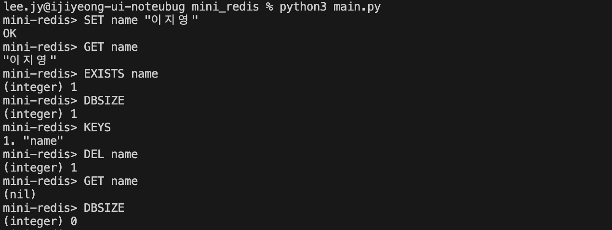
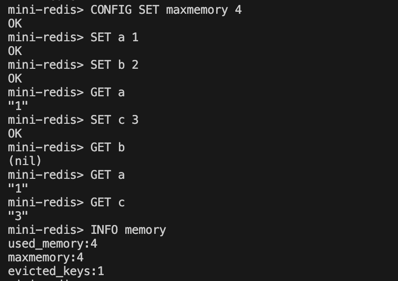
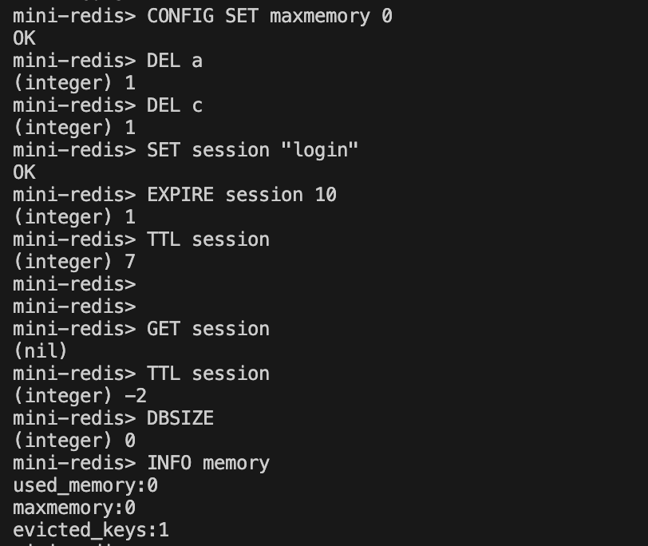
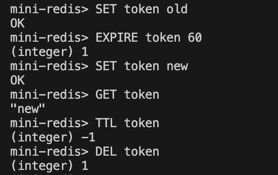
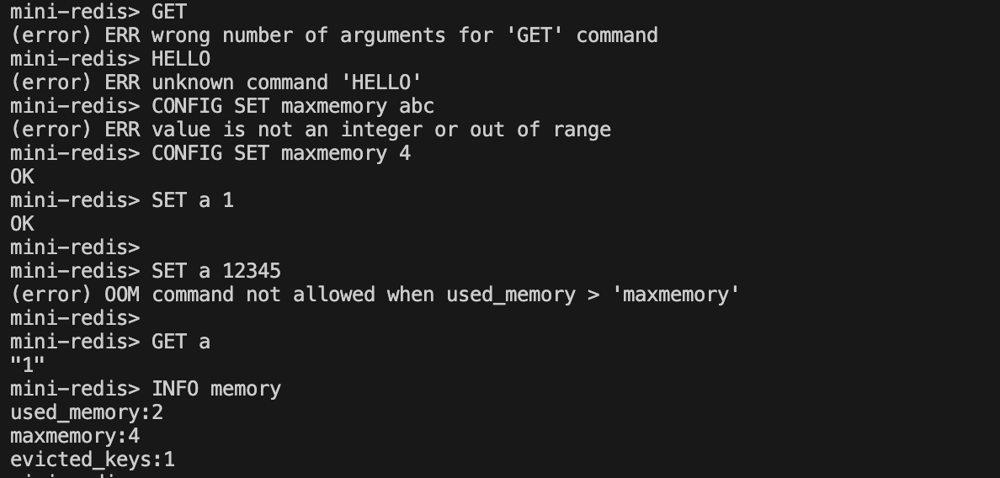
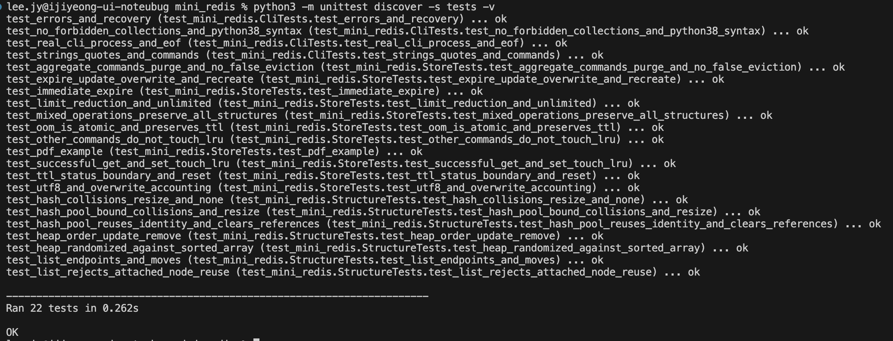
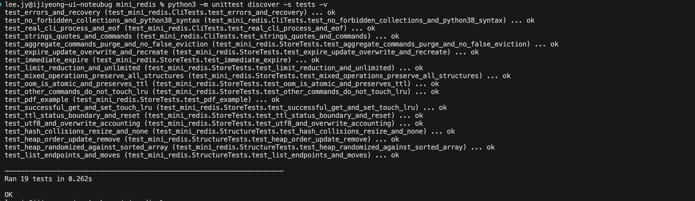

<!-- @format -->

# Mini Redis

Python으로 만든 이지영의 CLI 기반 Key-Value 저장소 학습 프로젝트입니다. 해시맵·이중 연결 리스트·최소 힙을 직접 구현하고, 문자열 명령어와 LRU 메모리 관리·TTL 만료 처리를 연결했습니다. 외부 패키지와 내장 `dict`, `set`, `collections`, `heapq`는 사용하지 않았습니다.

## 읽으면서 설명하는 방법

각 절의 **말로 설명하기** 인용문을 읽고, **화면에서 짚기**에 적힌 코드나 결과를 보여주면 됩니다. 아래의 자세한 표와 코드는 질문을 받았을 때 참고하는 자료입니다. 모든 코드 줄이나 긴 파일명을 외울 필요는 없습니다.

발표 흐름은 **소개(1절) → 실행 구조(3절) → 핵심 원리(4·6·7절) → 실제 화면(10·11절) → 확장 방향(15~17절)** 순서가 좋습니다. 14절은 노드 재사용과 구현 한계를 설명할 때 참고하세요. 구현한 기능은 “동작합니다”, 아직 하지 않은 확장은 “이렇게 설계할 수 있습니다”라고 구분해서 말합니다.

| 용어 | 쉬운 뜻 | 이 프로젝트의 예 |
| --- | --- | --- |
| 키 / 값 | 데이터를 찾는 이름 / 저장한 내용 | `name` / `이지영` |
| CLI | 글자로 명령을 입력하는 화면 | `mini-redis>`에 명령 입력 |
| REPL | 입력 → 실행 → 출력 → 다음 입력의 반복 | 명령을 한 줄씩 처리 |
| 자료구조 | 데이터를 담고 연결하는 방식 | 해시맵, 리스트, 힙 |
| 해시맵 / 버킷 | 이름으로 저장 위치를 찾는 구조 / 항목을 담는 칸 | 같은 칸의 키는 연결해서 보관 |
| 노드 / 참조 | 데이터와 연결을 담는 객체 / 다른 객체를 가리키는 연결 | `Entry.node`가 LRU 노드를 가리킴 |
| LRU | 가장 오래 사용하지 않은 데이터를 먼저 지우는 규칙 | 최근 조회한 키는 남김 |
| TTL | 데이터의 남은 유효 시간 | 10초 후 만료 |
| 최소 힙 | 가장 작은 항목을 맨 위에서 찾을 수 있는 구조 | 가장 빠른 만료 시각 확인 |
| OOM | 이 프로그램에서는 저장할 데이터가 설정한 제한보다 큰 오류 | 4바이트 제한에 6바이트 항목 저장 시도 |
| 오버헤드 | 값 자체 외에 관리하는 데 필요한 추가 비용 | 노드, 버킷, 위치 맵 |

## 1. 개발 목적과 학습 범위

**화면에서 짚기:** README 제목과 아래 명령 처리 흐름을 보여주세요.

**말로 설명하기**

> 안녕하세요. 이지영입니다. 제가 만든 Mini Redis는 이름을 붙여 데이터를 저장하고, 그 이름으로 다시 찾는 프로그램입니다. 예를 들어 name이라는 키에 이지영이라는 값을 저장합니다.
>
> 이번에는 저장만 하는 것이 아니라, 공간이 부족할 때 무엇을 지울지와 시간이 지나면 데이터를 어떻게 만료시킬지도 구현했습니다. 이를 위해 해시맵, 이중 연결 리스트, 최소 힙이라는 세 가지 자료구조를 사용했습니다.

이번 과제는 Redis의 빠른 조회와 메모리 관리가 어떤 자료구조로 동작하는지 이해하는 것이 목적입니다. 키로 값을 찾는 과정, 최근 사용 순서를 바꾸는 과정, 만료된 데이터를 삭제하는 과정을 직접 작성했습니다.

```text
사용자 명령 입력
  → shlex로 명령과 인자 분리
  → 명령·인자 개수·정수 형식 확인
  → 저장소 접근 시 만료된 키 정리
  → 데이터 조회·변경 또는 메모리·TTL 관리
  → Redis 스타일 결과 출력
  → 다음 명령 대기
```

키 조회에는 체이닝 해시맵, 최근 사용 순서에는 이중 연결 리스트, 가장 빠른 만료 탐색에는 최소 힙을 사용합니다. 자료구조를 독립된 모듈로 나누고 저장소와 CLI를 분리하여 각 역할을 확인할 수 있게 했습니다.

## 2. 개발 환경과 실행 조건

**화면에서 짚기:** 실행 명령과 `mini-redis>` 프롬프트를 보여주세요.

**말로 설명하기**

> Python이 설치된 터미널에서 python3 main.py를 실행하면 됩니다. 별도의 Redis 서버나 외부 패키지는 필요하지 않습니다. 데이터는 실행 중인 메모리에만 저장하므로 종료하면 사라집니다. 다시 실행하면 빈 상태에서 시작합니다.

| 구분                  | 내용                                             |
| --------------------- | ------------------------------------------------ |
| 언어                  | Python 3.8 이상 문법으로 작성                    |
| 실행 검증             | Python 3.13, Python 3.8 문법은 AST 파싱으로 확인 |
| 실행 환경             | Python을 실행할 수 있는 터미널                   |
| 실행 명령             | `python3 main.py` 또는 `python3 -m mini_redis`   |
| 인터페이스            | `mini-redis>` 프롬프트의 REPL                    |
| 프로그램 사용 모듈    | json, shlex, time 및 직접 작성한 모듈            |
| 테스트                | Python 표준 라이브러리 unittest                  |
| 데이터 저장           | 실행 중 메모리                                   |
| 외부 패키지·설치·빌드 | 필요 없음                                        |

네트워크와 별도의 Redis 서버 없이 실행합니다. 데이터 영속성은 구현하지 않았으므로 종료하면 모든 키와 통계가 사라집니다. 다시 실행하면 빈 저장소로 시작하며 별도 초기화 명령은 필요하지 않습니다.

## 3. 파일별 책임과 실행 순서

**화면에서 짚기:** 파일 표에서 cli.py, store.py, 자료구조 파일 세 개를 짚어주세요.

**말로 설명하기**

> 파일은 역할에 따라 나눴습니다. main.py는 시작 버튼에 해당하고, cli.py는 입력한 명령을 읽고 결과를 보여주는 역할입니다. store.py는 저장, 삭제, 만료처럼 실제 규칙을 처리합니다. 나머지 세 파일은 데이터를 찾고, 사용 순서를 관리하고, 만료 순서를 관리하는 자료구조입니다.
>
> 예를 들어 GET name을 입력하면 CLI가 명령을 확인하고 store에 조회를 요청합니다. store가 찾은 결과를 돌려주면 CLI가 화면에 출력합니다.

| 파일·폴더                 | 책임           | 주요 내용                                        |
| ------------------------- | -------------- | ------------------------------------------------ |
| main.py                   | 실행 진입점    | CLI의 main 호출                                  |
| `mini_redis/__main__.py`    | 모듈 실행      | `python3 -m mini_redis` 지원                     |
| `mini_redis/__init__.py`    | 공개 API       | MiniRedis 클래스 제공                            |
| mini_redis/cli.py         | 사용자 입출력  | 파싱, 인자 검사, 명령 분기, 응답 형식, REPL      |
| mini_redis/store.py       | 저장소 정책    | Entry, 문자열 명령, LRU, TTL, 메모리 집계        |
| mini_redis/hash_map.py    | 키 기반 조회   | UTF-8 해시, 체이닝 충돌 해결, 리해시             |
| mini_redis/linked_list.py | 연결과 순서    | Node, 양 끝 삽입·삭제, 임의 노드 이동            |
| mini_redis/min_heap.py    | 만료 순서      | 최소 힙, 키 위치 맵, 갱신과 임의 삭제            |
| tests/test_mini_redis.py  | 자동 검증      | 자료구조, 명령어, 경계 조건, CLI 프로세스        |
| docs/images/              | 실제 실행 화면 | 기본 명령·LRU·TTL·OOM·자동 테스트 캡처 8장 |
| README.md                 | 설계·실행 안내 | 구현 이유, 명령어, 실행 예시, 검증, 확장 설계    |
| .gitignore                | 추적 제외 설정 | Python 캐시와 macOS 메타데이터 제외              |

실행하면 `cli.main()`에서 `CommandProcessor`와 `MiniRedis` 객체를 생성합니다. `input()`으로 한 줄을 읽고 `execute()`에 전달한 뒤 응답을 출력합니다. 입력 오류가 있어도 다음 입력을 받으며 EXIT·QUIT·EOF·Ctrl+C로 종료합니다.

## 4. 핵심 코드와 구현 이유

### 명령 파싱과 문자열 인자

**말로 설명하기**

> 파싱은 입력을 나눠 뜻을 알아보는 과정입니다. SET name "Alice Kim"에서 공백만 보고 나누면 값이 두 개가 됩니다. shlex는 따옴표 안을 한 값으로 묶습니다. upper는 명령어만 대문자로 바꾸며, 키나 값은 그대로 둡니다.

```python
args = shlex.split(line, comments=False)
command = args[0].upper()
```

`shlex.split()`은 `SET name "Alice Kim"`의 값을 하나의 인자로 해석합니다. 코드에서는 빈 입력인지 먼저 확인한 뒤 `args[0]`에 접근합니다. 명령어만 대문자로 바꾸므로 키와 값의 대소문자는 유지됩니다. 결과 문자열은 `json.dumps(..., ensure_ascii=False)`로 따옴표를 붙이고 한글은 그대로 표시합니다.

### 직접 구현한 해시와 체이닝

**말로 설명하기**

> 해시는 키를 숫자로 바꿔 저장할 칸을 찾는 계산입니다. encode는 글자를 바이트로 바꾸고, ^는 비트를 섞는 XOR, &는 여기서 하위 64비트만 남기는 데 사용합니다. 해시를 칸 수로 나눈 나머지가 위치입니다. 같은 칸에 들어온 키는 연결 리스트에 이어서 저장하고 실제 이름을 비교합니다.
>
> 로드 팩터는 키 개수를 칸 수로 나눈 값입니다. 칸이 8개라면 키 6개는 정확히 0.75여서 유지하고, 7개가 되면 16개 칸으로 늘립니다. 칸 수가 바뀌므로 모든 키의 위치를 다시 계산합니다.

```python
result = 14695981039346656037
for byte in key.encode("utf-8"):
    result = ((result ^ byte) * 1099511628211) & 0xFFFFFFFFFFFFFFFF
```

FNV-1a 방식으로 UTF-8 바이트를 섞어 64비트 해시를 계산합니다. Python의 `hash()`는 사용하지 않습니다. `해시 % capacity`로 버킷을 선택하고 같은 버킷에 들어온 키는 이중 연결 리스트에 저장합니다. 충돌하더라도 실제 키를 비교하므로 값을 구분할 수 있습니다.

```python
if self._size * 4 > self.capacity * 3:
    old = self._buckets
    self._buckets = [None] * (self.capacity * 2)
```

로드 팩터가 0.75를 초과하면 버킷 수를 두 배로 늘립니다. 이후 기존 항목을 모두 재삽입하여 새 버킷 수에 맞는 위치를 계산합니다. 기존 키의 값만 변경하면 키 개수는 늘어나지 않습니다.

### 해시맵과 LRU 노드 연결

**말로 설명하기**

> insert_front는 새 키를 최근 사용 위치인 맨 앞에 넣습니다. 그때 반환한 노드를 Entry에 저장하고, 이 Entry를 해시맵에 넣습니다. 나중에 해시맵에서 찾으면 리스트의 어느 노드인지 바로 알 수 있습니다.

```python
entry = Entry(value, self._lru.insert_front(key))
self._data.put(key, entry)
```

새 키는 LRU 리스트의 맨 앞에 삽입합니다. Entry가 해당 노드의 참조를 보관하므로 해시맵에서 찾은 뒤 리스트를 다시 순회할 필요가 없습니다. 성공한 GET과 기존 키 SET은 `move_to_front(entry.node)`로 최근 사용 위치를 갱신합니다.

### 메모리 제한과 LRU 제거

**말로 설명하기**

> while은 조건이 맞는 동안 반복합니다. 제한이 양수이고 현재 사용량이 초과한 동안 가장 뒤의 키를 삭제합니다. 한 번 지운 뒤에도 초과하면 다시 지웁니다. evicted_keys는 이 경로에서만 증가하므로 직접 삭제나 TTL 만료와 구별됩니다.

```python
while self.maxmemory > 0 and self.used_memory > self.maxmemory:
    self._delete(self._lru.tail.data)
    self.evicted_keys += 1
```

리스트의 뒤인 tail이 가장 오래 사용하지 않은 키입니다. 제한 이하가 될 때까지 반복 제거하며 각 제거를 통계에 누적합니다. DEL과 TTL 만료도 `_delete()`로 자료구조를 함께 정리하지만 `evicted_keys`를 증가시키지는 않습니다.

### 최소 힙과 TTL

**말로 설명하기**

> expire_at은 만료될 시각입니다. 현재 경과 시간에 seconds를 더해 만들고 키와 함께 힙에 저장합니다. 힙은 모든 데이터를 완전히 정렬한 배열은 아니지만 가장 작은 만료 시각을 맨 위에서 바로 찾게 해 줍니다. 같은 키의 시간을 바꾸면 기존 항목을 갱신합니다.

```python
entry.expire_at = self._clock() + seconds
self._expiry.push((entry.expire_at, key))
```

EXPIRE는 남은 초를 절대 만료 시각으로 변환해 최소 힙에 저장합니다. 가장 빠른 만료가 루트에 있으므로 전체 키를 매번 순회하지 않아도 됩니다. 시스템 시각 변경의 영향을 피하도록 `time.monotonic()`을 사용합니다.

힙과 함께 `key → 배열 인덱스`를 저장하는 자체 해시맵을 둡니다. 같은 키의 TTL을 다시 설정하면 기존 항목을 갱신하고, DEL·덮어쓰기·LRU 제거 시 만료 항목을 실제로 제거하여 오래된 예약이 쌓이지 않게 합니다.

## 5. 필수 요구사항별 구현 근거

**화면에서 짚기:** 아래 표에서 문자열 명령, 메모리 관리, TTL 세 묶음을 짚어주세요.

**말로 설명하기**

> 구현한 기능은 크게 세 묶음입니다. 기본 저장과 조회 명령 여섯 개, 메모리 설정과 정보 명령 두 개, 만료 설정과 조회 명령 두 개입니다. 각 기능이 어느 코드에 연결되는지 이 표에 정리했습니다.

주요 기능과 구현 위치를 정리했습니다.

| 번호 | 요구사항                   | 구현 근거                                                                          |
| ---- | -------------------------- | ---------------------------------------------------------------------------------- |
| 1    | 이중 연결 리스트           | prev/next/data 노드, 6개 삽입·삭제·이동 메서드                                     |
| 2    | 체이닝 해시맵              | put/get/remove/contains/keys/size, 직접 구현한 해시, 최대 64개 체인 노드 재사용 풀 |
| 3    | 로드 팩터에 따른 확장      | 0.75 초과 시 버킷 2배 및 리해시                                                    |
| 4    | 최소 힙                    | push/pop/peek/size, heapify_up/down, TTL 위치 맵                                   |
| 5    | 문자열 명령 6개            | SET/GET/DEL/EXISTS/DBSIZE/KEYS                                                     |
| 6    | 메모리 명령 2개            | CONFIG SET maxmemory, INFO memory                                                  |
| 7    | LRU 자동 제거              | 성공한 SET/GET의 앞 이동, 초과 시 tail 반복 삭제                                   |
| 8    | TTL 명령 2개               | EXPIRE/TTL, 명령 처리 시 힙 기반 만료 정리                                         |
| 9    | 연계 삭제와 덮어쓰기       | DEL의 데이터·LRU·TTL 삭제, SET의 TTL 초기화                                        |
| 10   | Redis 스타일 출력과 오류   | OK, (nil), (integer), (error), OOM                                                 |
| 11   | 내장 Key-Value 컬렉션 제한 | dict/set/collections 미사용, 리스트는 배열·결과 나열에 사용                        |
| 12   | 독립 모듈과 설명           | 자료구조별 파일 분리, 한국어 주석과 docstring                                      |

동적 배열 별도 구현, 스택/큐/덱 과제, 이진 트리/BST, Pub/Sub는 선택 보너스이므로 포함하지 않았습니다.

## 6. 자료구조와 알고리즘의 시간복잡도

**화면에서 짚기:** 평균 O(1)과 최악 O(n), 최소 힙의 비용을 비교해 보여주세요.

**말로 설명하기**

> 시간복잡도는 데이터가 많아질 때 필요한 작업이 얼마나 늘어나는지를 나타냅니다. O(1)은 데이터 수가 늘어도 해당 작업 횟수가 대체로 일정하다는 뜻이지, 실행 시간이 1초라는 뜻은 아닙니다.
>
> 해시맵 조회는 평균적으로 빠르지만 한 칸에 키가 몰리면 여러 개를 비교해야 합니다. 리스트는 대상 노드를 이미 알고 있을 때 연결만 바꾸므로 O(1)입니다. 힙은 위아래로 이동하는 단계가 로그 형태로 늘어납니다. 그래서 모든 명령이 항상 똑같이 빠르다고 설명하지는 않습니다.

n은 저장된 키 수, t는 TTL이 있는 키 수, k는 이번에 정리할 만료 키 수, b는 해시맵 버킷 수입니다. 아래 복잡도는 키 길이를 일정하게 보았을 때의 기준입니다.

| 구조·작업                  | 시간복잡도                  | 근거                                                     |
| -------------------------- | --------------------------- | -------------------------------------------------------- |
| 해시맵 조회·삭제           | 평균 O(1), 최악 O(n)        | 버킷 선택 후 충돌 체인 탐색                              |
| 해시맵 삽입                | 평균 상환 O(1)              | 확장 시에는 전체 재삽입 비용 발생                        |
| 리해시                     | 정상적인 해시 분포에서 O(n) | 새 버킷에 모든 항목 재삽입, 충돌 집중 시 더 커질 수 있음 |
| 연결 리스트 삽입·삭제·이동 | O(1)                        | 인접 노드와 head/tail만 변경                             |
| 최소 힙 peek               | O(1)                        | 배열의 첫 항목 확인                                      |
| 최소 힙 삽입·갱신·삭제     | 평균 상환 O(log(t+1))       | 높이만큼 이동, 자체 위치 해시맵 비용 포함                |
| 만료 정리                  | 평균 상환 O(k log(t+1))     | 만료된 루트부터 반복 삭제                                |
| KEYS                       | O(b+n), 출력 길이 비용 별도 | 버킷 순회 및 키 목록 생성                                |
| DBSIZE                     | 만료 정리 이후 O(1)         | 저장된 size 값 반환                                      |

해시 계산은 키의 UTF-8 바이트 길이에 비례합니다. SET의 크기 계산은 키와 값의 바이트 길이에 비례하며, 메모리 초과 시 여러 키 제거 비용이 추가됩니다. GET의 LRU 이동은 O(1)이지만 명령 앞의 만료 정리 비용은 별도입니다. 해시 충돌과 리사이즈 때문에 모든 명령이 항상 O(1)이라고 볼 수는 없습니다.

## 7. 저장소 구조와 LRU 변화

**화면에서 짚기:** 구조도의 Entry.node와 head/tail을 짚고 아래 a·b 예시를 따라가세요.

**말로 설명하기**

> 해시맵은 키를 빨리 찾고, 리스트는 사용한 순서를 기억합니다. 리스트만 사용하면 키를 찾으려고 순서대로 뒤져야 하고, 해시맵만 사용하면 최근 사용 순서를 바로 알기 어렵습니다. 그래서 두 구조를 함께 썼습니다.
>
> Entry는 값과 관련 정보를 묶은 객체입니다. 이 안에 자신의 리스트 노드를 가리키는 연결을 보관합니다. 키를 찾으면 그 노드를 바로 앞으로 옮길 수 있습니다. 앞은 가장 최근, 뒤는 가장 오래 사용하지 않은 키입니다.

아래는 자료구조의 역할을 설명한 구조도이며 실제 화면 캡처는 아닙니다.

```text
key → HashMap → Entry(value, expire_at, node)
                                      │
                                      └→ LRU 리스트의 해당 노드

LRU: head [가장 최근 키] ↔ [...] ↔ [가장 오래된 키] tail
TTL: 최소 힙 [(가장 빠른 expire_at, key), ...]
     위치 맵 [key → 힙 배열 인덱스]
```

예를 들어 다음 순서에서 왼쪽을 가장 최근 사용 위치로 봅니다.

| 명령                     | LRU 순서 | 의미                                     |
| ------------------------ | -------- | ---------------------------------------- |
| `SET a 1`                | a        | 새 키를 앞에 삽입                        |
| `SET b 2`                | b → a    | a가 가장 오래된 키                       |
| `GET a`                  | a → b    | 성공한 조회가 a를 앞으로 이동            |
| `EXISTS b`               | a → b    | 존재 확인은 최근 사용 순서를 바꾸지 않음 |
| `CONFIG SET maxmemory 2` | a        | 각각 2바이트인 두 키 중 tail인 b 제거    |

## 8. 로컬 실행과 입력 방법

**화면에서 짚기:** 터미널의 일반 프롬프트와 프로그램 프롬프트를 구별해서 보여주세요.

**말로 설명하기**

> 먼저 일반 터미널에서 프로그램을 실행합니다. mini-redis 프롬프트가 나타나면 SET이나 GET을 입력합니다. 테스트 실행 명령은 여기에 넣지 않고 QUIT으로 나온 뒤 일반 터미널에 입력해야 합니다.

1. 프로젝트 폴더를 터미널에서 엽니다.
2. `python3 main.py`를 실행합니다.
3. `mini-redis>`이 나타나면 `SET name "Jiyoung"`을 입력합니다.
4. `GET name`으로 저장한 값을 확인합니다.
5. `QUIT`으로 종료하면 일반 터미널로 돌아옵니다.

```sh
python3 main.py
```

`mini-redis>`은 프로그램이 표시하는 프롬프트이므로 직접 입력하지 않습니다. `%` 또는 `$`가 있는 일반 터미널에서는 Python 실행·테스트·실제 Git 명령을 사용하고, `mini-redis>`에서는 아래의 Mini Redis 명령을 사용합니다.

## 9. 명령어와 메모리·TTL 규칙

**화면에서 짚기:** 명령 표와 사용량 계산식을 보여주세요.

**말로 설명하기**

> SET은 저장, GET은 조회, DEL은 삭제입니다. EXISTS는 존재 여부, DBSIZE는 키 개수, KEYS는 키 목록을 보여줍니다. EXPIRE는 유효 시간을 설정하고 TTL은 남은 시간을 보여줍니다.
>
> 메모리 사용량은 글자 수가 아니라 UTF-8 바이트 수로 계산합니다. 한글은 영문과 바이트 수가 다를 수 있습니다. 단일 키와 값이 제한보다 크면 OOM을 반환하고 기존 값을 유지합니다. 전체 저장량만 초과했다면 오래 사용하지 않은 키부터 지웁니다.

| 명령                         | 동작과 반환값                                                 |
| ---------------------------- | ------------------------------------------------------------- |
| `SET key value`              | 저장 또는 덮어쓰기, TTL 초기화, LRU 갱신. `OK`                |
| `GET key`                    | 성공하면 LRU 갱신 후 `"value"`, 없거나 만료되면 `(nil)`       |
| `DEL key`                    | 데이터·LRU·TTL 삭제. 성공 `1`, 없는 키 `0`                    |
| `EXISTS key`                 | 존재하면 `1`, 없으면 `0`                                      |
| `DBSIZE`                     | 만료되지 않은 키 수                                           |
| `KEYS`                       | 번호가 붙은 전체 키 목록 또는 `(empty array)`, 패턴 인자 없음 |
| `CONFIG SET maxmemory bytes` | 0 이상의 정수로 제한 설정. 0은 무제한. `OK`                   |
| `INFO memory`                | used_memory/maxmemory/evicted_keys 출력                       |
| `EXPIRE key seconds`         | 성공 `1`, 없는 키 `0`. 0 이하이면 즉시 삭제                   |
| `TTL key`                    | 남은 초 내림, 만료 예약 없음 `-1`, 없는 키 `-2`               |
| `EXIT` / `QUIT`              | 프로그램 종료                                                 |

숫자 결과는 `(integer) N` 형식입니다. 명령어와 CONFIG/INFO 옵션은 대소문자를 구분하지 않고 키·값은 구분합니다. 공백 없는 문자열, 큰따옴표·작은따옴표 문자열, 빈 문자열을 지원합니다. 따옴표와 역슬래시는 `shlex`의 POSIX 규칙을 따릅니다. 정수는 ASCII 숫자와 선택적 부호를 허용하며 signed 64-bit 범위를 검사합니다.

### 메모리 계산과 OOM

```text
used_memory = Σ(len(key.encode('utf-8')) + len(value.encode('utf-8')))
```

노드·포인터·버킷 등 구조체 오버헤드는 제외합니다. `이름` → `홍길동`은 6 + 9 = 15바이트입니다. 덮어쓸 때는 기존 크기를 빼고 새 크기를 더하며, 삭제할 때는 삭제한 크기를 뺍니다.

단일 엔트리가 제한보다 크면 저장 전에 OOM을 반환하여 기존 값·TTL·LRU를 보존합니다. 이미 만료된 키의 정리는 수행합니다. 저장 가능한 엔트리이지만 전체 사용량이 초과하면 LRU 순서로 제거합니다. CONFIG로 제한을 낮추면 즉시 LRU 제거를 수행합니다.

### TTL과 갱신 순서

GET은 만료 정리 → 키 조회 → 존재하는 경우만 LRU 갱신 → 값 반환 순서입니다. SET으로 덮어쓰면 이전 TTL이 취소됩니다. DEL과 만료 삭제는 데이터·LRU·TTL 구조를 함께 정리합니다.

만료 정리는 저장소 명령 처리 시 실행하며 유휴 중에는 실행하지 않습니다. 다음 명령에서 밀린 만료를 정리하므로 응답이 늦어질 수 있습니다. TTL은 정리 시점의 시각을 기준으로 판정하고, 남은 시간이 1초 미만이면 0을 반환할 수 있습니다.

## 10. 실행 예시와 실제 테스트 결과

발표에서는 아래 **실제 테스트 1~5**의 이미지를 차례로 보여주며 인용문을 읽으세요. PDF 기반 텍스트 예시는 참고용이므로 중복해서 읽지 않아도 됩니다.

### PDF 기반 실행 예시

다음 텍스트는 PDF 예시와 자동 테스트에서 검증하는 시나리오를 정리한 것입니다. 그 아래에는 사용자가 직접 실행하고 캡처한 실제 테스트 화면을 별도로 첨부했습니다.

```text
mini-redis> CONFIG SET maxmemory 30
OK
mini-redis> SET user:1 "Alice"
OK
mini-redis> SET user:2 "Bob"
OK
mini-redis> SET user:3 "Charlie"
OK
mini-redis> GET user:1
(nil)
mini-redis> INFO memory
used_memory:22
maxmemory:30
evicted_keys:1
mini-redis> DBSIZE
(integer) 2
mini-redis> EXPIRE user:2 0
(integer) 1
mini-redis> TTL user:2
(integer) -2
mini-redis> KEYS
1. "user:3"
mini-redis> QUIT
```

| 확인 항목   | 실행 결과와 의미                           |
| ----------- | ------------------------------------------ |
| 키별 크기   | user:1은 11, user:2는 9, user:3은 13바이트 |
| 메모리 초과 | 세 키의 합 33이 제한 30을 초과             |
| LRU 제거    | 가장 오래된 user:1 제거 후 22바이트        |
| 통계        | LRU로 1개 제거했으므로 evicted_keys는 1    |
| 즉시 만료   | EXPIRE의 0초 설정으로 user:2 삭제          |
| TTL 확인    | 삭제된 user:2는 -2                         |
| 최종 키     | user:3만 남음, 종료하면 이 키도 사라짐     |

시간 경과에 따른 만료를 확인하려면 `SET temp hello`, `EXPIRE temp 3`, `TTL temp`를 차례로 실행하고 3초 이상 지난 뒤 `GET temp`를 입력합니다. 마지막 결과는 `(nil)`이며 중간 TTL 값은 입력 속도에 따라 달라집니다.

### 실제 테스트 1: 기본 저장·조회·삭제

**말로 설명하기**

> 여기서 이름을 저장한 뒤 조회하면 이지영이 나옵니다. 존재 여부와 키 개수는 1이고 목록에는 name이 있습니다. 삭제한 뒤에는 nil과 개수 0이 나와 삭제까지 확인할 수 있습니다.



`SET name "이지영"` 후 GET으로 같은 값을 조회했습니다. EXISTS와 DBSIZE는 1, KEYS는 `name`을 반환했습니다. DEL 이후 GET은 `(nil)`, DBSIZE는 0이 되어 삭제까지 확인했습니다.

### 실제 테스트 2: LRU 자동 제거와 메모리 통계

**말로 설명하기**

> a와 1은 합쳐 2바이트이고 b와 2도 2바이트입니다. 제한은 4바이트입니다. a를 조회해서 최근 사용으로 바꾼 뒤 c를 넣자 b가 삭제됐습니다. 결과에서 b는 nil이고 사용량은 4, 제한은 4, 제거 횟수는 1입니다.



`a → 1`, `b → 2`는 각각 2바이트입니다. `GET a`로 a를 최근 사용한 뒤 c를 추가하자 가장 오래 사용하지 않은 b가 제거되었습니다. GET b는 `(nil)`, a와 c는 원래 값을 반환했고, INFO는 `used_memory:4`, `maxmemory:4`, `evicted_keys:1`을 출력했습니다.

### 실제 테스트 3: TTL 설정과 시간 경과 후 만료

**말로 설명하기**

> session의 유효 시간을 10초로 설정했습니다. 처음 조회할 때는 7초가 남았고, 시간이 지난 뒤에는 값이 사라졌습니다. TTL은 -2, 키 개수와 사용량은 0입니다. TTL로 지운 것이므로 LRU 제거 횟수는 이전의 1을 유지합니다.



제한을 해제하고 앞의 키를 삭제한 뒤 session에 10초의 TTL을 설정했습니다. 첫 TTL 조회는 `(integer) 7`이었고, 만료 후 GET은 `(nil)`, TTL은 -2, DBSIZE는 0을 반환했습니다. 사용량은 0이 되었으며 `evicted_keys:1`은 유지되어 TTL 만료가 LRU 제거 횟수에 포함되지 않음을 확인했습니다.

### 실제 테스트 4: 덮어쓰기 시 TTL 초기화

**말로 설명하기**

> token에 유효 시간을 설정했지만 SET으로 값을 new로 바꾸면 기존 만료 예약이 취소됩니다. 값은 new이고 TTL은 -1입니다. -1은 키가 없다는 뜻이 아니라 유효 시간 제한이 없다는 뜻입니다.



token에 60초의 TTL을 설정한 뒤 `SET token new`로 덮어썼습니다. GET은 `"new"`, TTL은 -1을 반환하여 값 변경과 만료 예약 취소를 확인했습니다. 마지막 DEL은 1을 반환했습니다.

### 실제 테스트 5: 오류 처리와 OOM 상태 보존

**말로 설명하기**

> 인자 없는 GET, 없는 명령 HELLO, 숫자가 아닌 abc에 각각 오류가 나옵니다. 그다음 너무 큰 값으로 덮어쓰면 OOM이 발생하지만 기존 값 1은 남아 있습니다. 오류 뒤에도 정상 명령을 계속 실행할 수 있습니다.



인자가 없는 GET, 알 수 없는 HELLO, 정수가 아닌 maxmemory 입력에 각각 오류가 출력되었습니다. 이후 정상 명령을 계속 실행할 수 있었습니다. 4바이트 제한에서 `SET a 12345`는 단일 엔트리가 6바이트이므로 OOM을 반환했고, GET a는 기존 값 `"1"`을 유지했습니다. INFO의 사용량은 2바이트, 제한은 4바이트, 누적 LRU 제거 횟수는 앞 단계와 같은 1이었습니다.

## 11. 확인된 내용과 검증 방법

**화면에서 짚기:** 이 절의 최신 이미지 08에서 22 tests와 OK를 짚어주세요.

**말로 설명하기**

> 이 화면은 자동 테스트 결과입니다. 총 22개가 모두 통과했습니다. 저장과 조회뿐 아니라 만료되는 경계, 메모리 제한, 해시 충돌, 노드 재사용도 검사했습니다.
>
> 노드 재사용 테스트에서는 값이 같은지만 확인하지 않고 assertIs로 같은 객체인지 확인합니다. 다만 테스트 통과가 모든 장애와 대규모 성능을 보장하는 것은 아닙니다. 여기서는 작성한 기능과 경계 조건의 정상 동작을 확인한 것입니다.

### 자동 테스트 실행

Mini Redis를 실행 중이라면 먼저 `QUIT`으로 종료한 뒤 일반 터미널에서 실행합니다. 아래는 사용자가 QUIT을 입력한 화면입니다.


```sh
python3 -m unittest discover -s tests -v
```

노드 풀 검증 3개를 추가한 현재 버전은 테스트 **22개가 모두 통과**했습니다. 아래는 주요 검증을 묶어 정리한 것입니다.

| 분류           | 개수 | 기능·주제                                                                                       |
| -------------- | ---- | ----------------------------------------------------------------------------------------------- |
| StructureTests | 7    | 리스트 연결, 강제 해시 충돌·확장, 힙 갱신·삭제, 무작위 힙 순서, 노드 재사용·풀 상한·연결 안전성 |
| StoreTests     | 11   | UTF-8 집계, PDF 예시, LRU, OOM 상태 보존, TTL, 구조 일관성                                      |
| CliTests       | 4    | 명령 출력, 입력 오류와 복구, 실제 프로세스 실행·EOF, 금지 컬렉션·문법 검사                      |

고정 시드로 힙 작업 1,500회와 저장소 혼합 작업 1,000회를 실행하여 위치 맵·LRU·키 개수·메모리 합의 일관성을 검사합니다. TTL은 가상 시계를 주입하므로 실제로 기다리지 않고 만료 경계를 확인합니다. 실제 CLI 프로세스도 실행하여 두 진입점과 종료를 검증합니다.

### 사용자가 확인한 최신 결과 (노드 풀 추가 후)



최신 실행 화면에서 `Ran 22 tests in 0.262s`와 마지막 `OK`를 확인했습니다. 기존 기능과 노드 풀 검증 3개를 포함한 전체 테스트가 통과했습니다. 0.262초는 해당 실행의 측정값이며 환경에 따라 달라집니다.

| 추가 테스트                                            | 화면에서 확인한 결과                         |
| ------------------------------------------------------ | -------------------------------------------- |
| `test_hash_pool_reuses_identity_and_clears_references` | `ok`: 동일 노드 객체 재사용과 이전 참조 해제 |
| `test_hash_pool_bound_collisions_and_resize`           | `ok`: 풀 상한과 충돌·리해시 이후 구조 일관성 |
| `test_list_rejects_attached_node_reuse`                | `ok`: 연결 중인 노드의 중복 삽입 차단        |

다음은 변경 전 19개 테스트가 통과했던 기록입니다. 현재 버전의 검증 근거는 위의 22개 테스트 화면입니다.

### 사용자가 확인한 결과 (노드 풀 추가 전)



이 기록은 노드 풀 추가 전 버전이며 현재 22개 테스트 결과와 구분합니다. 사용자가 일반 터미널에서 실행한 화면에 `Ran 19 tests in 0.262s`와 마지막 `OK`가 표시되어 있습니다. 이는 작성된 자동 테스트 19개에 실패나 오류가 없다는 의미입니다. 0.262초는 이 캡처의 테스트 실행 시간이며, 컴퓨터 환경에 따라 달라집니다.

10만 키 처리량, 실제 프로세스 메모리 한계, LFU 성능은 측정하지 않았습니다. 뒤의 확장 설계는 구현된 기능이나 실측 결과와 구분합니다.

## 12. 자주 만나는 상황과 해결 방법

**화면에서 짚기:** 오류 상황과 해결 방법 표를 짚어주세요.

**말로 설명하기**

> nil은 조회할 값이 없다는 의미입니다. TTL의 -1은 키는 있지만 만료 시간이 없다는 뜻이고, -2는 키 자체가 없다는 뜻입니다. unknown command는 지원하지 않는 명령을 입력했다는 뜻입니다. 오류가 나면 입력을 고쳐 다시 실행할 수 있습니다.

| 화면 또는 상황                            | 이유와 해결 방법                                                                   |
| ----------------------------------------- | ---------------------------------------------------------------------------------- |
| `mini-redis>`만 표시됨                    | 정상입니다. 명령 입력을 기다리는 중입니다.                                         |
| `(error) ERR unknown command 'python3'`   | 프로그램 안에 터미널 명령을 입력한 상태입니다. QUIT 후 실행하세요.                 |
| `(nil)`                                   | 없는 키이거나 TTL 만료·LRU 제거로 사라진 키입니다.                                 |
| TTL이 `-1`                                | 키는 있지만 만료 시간이 없습니다. SET 덮어쓰기도 TTL을 초기화합니다.               |
| TTL이 `-2`                                | 키가 존재하지 않습니다.                                                            |
| `wrong number of arguments`               | 명령별 인자 개수와 따옴표를 확인하세요. KEYS에는 패턴을 넣지 않습니다.             |
| `value is not an integer or out of range` | 정수 형식·범위를 확인하세요. maxmemory는 음수가 될 수 없습니다.                    |
| `unbalanced quotes or invalid escape`     | 문자열의 따옴표가 닫혔는지, 역슬래시가 올바른지 확인하세요.                        |
| OOM 오류                                  | 단일 키와 값의 UTF-8 바이트 합이 제한보다 큽니다. 값을 줄이거나 제한을 조정하세요. |
| 다시 켰더니 데이터가 없음                 | 메모리 기반 프로그램이므로 정상입니다.                                             |

잘못된 명령의 예시는 `(error) ERR unknown command 'HELLO'`, OOM 출력은 `(error) OOM command not allowed when used_memory > 'maxmemory'`입니다. 정상적인 입력 오류 후에는 다시 명령을 입력할 수 있습니다.

## 13. 사용 기술과 제출 범위

**화면에서 짚기:** 파일 구조에서 내부 패키지와 tests, docs/images를 보여주세요.

**말로 설명하기**

> 실행 파일 하나만 있는 구조가 아니라 여러 파일을 불러오는 구조입니다. 따라서 main.py와 mini_redis 폴더를 함께 보관해야 합니다. tests는 자동 검증, docs/images는 실제 실행 화면을 담고 있습니다.

Python 리스트는 버킷 배열·힙 배열·출력 목록으로만 사용하고, 해시맵·LRU·힙 알고리즘을 내장 컬렉션으로 대체하지 않습니다. 자료구조별 핵심 함수와 명령 처리에는 한국어 주석을 작성했습니다.

```text
mini_redis/
├── main.py
├── README.md
├── .gitignore
├── mini_redis/
│   ├── __init__.py
│   ├── __main__.py
│   ├── cli.py
│   ├── store.py
│   ├── hash_map.py
│   ├── linked_list.py
│   └── min_heap.py
├── tests/
│   └── test_mini_redis.py
└── docs/
    └── images/
        └── 01.png ~ 08.png
```

실행을 위해 main.py뿐 아니라 내부 `mini_redis/` 패키지도 함께 제출해야 합니다. 검증 재현을 위해 tests/와 README도 포함하고, 실제 테스트 이미지가 표시되도록 docs/images/의 PNG 8장도 함께 제출합니다. 네트워크 통신·파일 저장·Redis 복잡 자료형·멀티스레딩은 구현 범위에 포함하지 않습니다. 실제 Redis 서버와 통신하는 프로그램이 아니라 핵심 자료구조를 학습하는 독립 CLI입니다.

## 14. 세부 동작과 구현 한계

**화면에서 짚기:** 노드 재사용 정책과 실패 정책을 보여주세요.

**말로 설명하기**

> 삭제할 때는 값만 지우면 안 됩니다. 데이터 해시맵, 사용 순서 리스트, 만료 힙과 사용량을 함께 바꿔야 합니다. 그래서 공통 삭제 함수를 사용했습니다.
>
> 해시맵에서 삭제된 체인 노드는 이전 키와 값의 연결을 비운 뒤 최대 64개까지 보관하고 다시 사용합니다. 64는 보관량을 제한하려고 정한 값이며 최적값을 실험한 것은 아닙니다.
>
> 실제 컴퓨터 메모리가 부족해 변경 도중 실패하면 현재는 전체를 되돌리는 기능이 없습니다. 이를 개선하려면 새 해시 테이블을 완성한 뒤 교체하는 방식과 여러 구조의 변경을 함께 관리하는 절차가 필요합니다.

다음 내용은 명령 처리와 자료구조의 동작 근거 및 구현 한계를 설명합니다. LFU와 병렬 서버는 확장 설계이며 현재 구현 기능이 아닙니다.

### 명령 처리와 통계 갱신 경로

- **SET**: `MiniRedis.set`에서 만료 정리 → 단일 엔트리 OOM 검사 → 새 노드 앞 삽입 또는
  `Entry.node`를 앞으로 이동 → 기존 TTL 제거 → 메모리 갱신 → `_evict` 순서로 실행합니다.
- **GET**: `MiniRedis.get`에서 `purge_expired()` → 해시 조회 → 없는 키면 즉시 반환 →
  `move_to_front(entry.node)` → 값 반환 순서입니다. 명령 시작 시각에 이미 만료된 키는 LRU를 갱신하지 않습니다.
  TTL 판정은 정리 시작 시점의 시각을 기준으로 하며 명령 실행 도중 흐른 시간까지 매 단계 재검사하지 않습니다.
- **DEL**: `MiniRedis.delete` → `_delete` → 데이터 해시맵 삭제·사용량 감소·LRU 노드 삭제·TTL 힙 삭제입니다.
- **상호 참조**: `key → HashMap → Entry → Entry.node → LRU 노드` 경로 덕분에 LRU 노드를 다시 탐색하지 않습니다.
  해시 조회는 평균 O(1), 이미 찾은 노드의 이동은 최악 O(1)이며 문자열 길이와 만료 정리 비용은 별도입니다.
- **제거 순서**: `_evict`의 `self._delete(self._lru.tail.data)`가 가장 오래 사용하지 않은 키를 제거하는 지점입니다.

`memory_info()`는 먼저 만료를 정리한 뒤 통계를 읽습니다. `used_memory`는 `set()`에서 기존 크기를 빼고
새 크기를 더하며, `_delete()`에서 삭제한 크기만큼 감소합니다. `maxmemory`는 `configure_maxmemory()`에서
바뀝니다. `evicted_keys`는 `_evict()`의 성공한 LRU 삭제 직후에만 증가합니다. SET 또는 CONFIG가 이 경로를
호출할 수 있으며, 직접 DEL이나 TTL 만료는 이 카운터를 증가시키지 않습니다.

`purge_expired()`는 명령이 저장소에 접근할 때 실행합니다. 힙 항목을 남겨두는 lazy deletion 방식은 아니며,
유휴 중에는 정리를 실행하지 않는다는 의미에서 지연 정리입니다. 다음 명령에서 밀린 만료를 모두 처리하므로
그 명령의 응답이 늦어질 수 있습니다. OOM 선검사에 의한 상태 보존은 설정한 논리적 `maxmemory` 초과에 대한
보장입니다. 아래의 실제 메모리 할당 실패까지 원자성을 보장하는 것은 아닙니다.

### 자료구조 근거와 실패 정책

연결 리스트의 삽입·삭제는 인접 노드와 head/tail만 수정합니다. `move_to_front`도 `remove_node`와
`_attach_front`만 호출하므로 노드 수와 무관하게 O(1)입니다. 실행 시간 테스트만으로 복잡도를 입증하기보다
코드에 순회가 없고 변경하는 포인터 수가 일정하다는 점이 근거입니다.

해시에서 버킷까지의 과정은 `key.encode('utf-8') → _hash(key) → 해시 % capacity`입니다.
예를 들어 계산된 해시가 27이고 버킷 수가 8이라면 인덱스는 `27 % 8 = 3`입니다(설명용 숫자).
다른 키도 인덱스 3이면 해당 버킷의 연결 리스트에 함께 저장하고 실제 키 문자열을 비교해 구분합니다.
16개 버킷으로 확장하면 같은 해시의 인덱스는 11이므로 모든 키를 다시 배치해야 합니다.

### 체이닝 노드 재사용 정책

해시맵마다 **최대 64개의 빈 노드를 보관하는 재활용 풀**을 구현했습니다. 고정 길이 배열과 개수 인덱스로 관리하며, 풀에 넣고 꺼내는 연산은 O(1)입니다.

```text
HashMap.remove(key)
  → 버킷 리스트에서 노드 분리 (prev/next/owner 해제)
  → _release_node: data를 None으로 바꿔 이전 키·값 참조 해제
  → 풀에 여유가 있으면 보관, 상한 초과 시 Python 메모리 관리에 맡김

HashMap.put(new_key, value)
  → _acquire_node: 풀에 노드가 있으면 꺼내 새 데이터 설정
  → 풀이 비었을 때만 Node 생성
  → insert_back_node로 대상 버킷에 기존 객체 연결
```

`insert_back_node`는 다른 리스트에 연결된 노드를 거부해 중복 연결을 방지합니다. 기존 키의 덮어쓰기는 원래 체인 노드의 데이터만 바꾸므로 풀을 소비하지 않습니다. 풀은 해시맵 인스턴스별로 독립적이며 저장소 데이터 맵과 TTL 위치 맵에 각각 적용됩니다. LRU 노드를 삭제 후 풀에 보관하는 기능은 추가하지 않았습니다.

리해시의 재삽입도 `_acquire_node`를 사용하므로 풀에 있는 빈 노드를 우선 사용합니다. 다만 이전 버킷에서 사용 중이던 노드를 직접 이전하거나 풀에 회수하는 최적화는 하지 않습니다. 이전 버킷은 참조가 없어지면 Python 메모리 관리 대상이 됩니다.

풀은 반복 삭제·삽입에서 Node 생성 횟수를 줄이는 대신 해시맵마다 최대 64개 노드와 고정 배열을 보관합니다. 이전 키·값은 보관하지 않으며, 이 구조체 비용은 과제의 논리적 `used_memory` 계산에서 제외합니다. 실제 실행 시간 개선 폭은 측정하지 않았습니다.

| 추가 테스트                                            | 검증 근거                                                                                              |
| ------------------------------------------------------ | ------------------------------------------------------------------------------------------------------ |
| `test_hash_pool_reuses_identity_and_clears_references` | 삭제 전후 동일 Node 객체가 다음 삽입에 재사용되는지 `assertIs`로 확인, 이전 데이터·연결 참조 해제 확인 |
| `test_hash_pool_bound_collisions_and_resize`           | 100개 삭제 후 풀 상한 64개, 이후 강제 충돌과 리해시를 거쳐 값·노드 연결·개수 검증                      |
| `test_list_rejects_attached_node_reuse`                | 연결 중인 노드의 중복 삽입 거부, 분리 후 다른 리스트에 같은 객체 연결 확인                             |

**현재 리해시는 할당 실패 시 롤백을 보장하지 않습니다.** 새 버킷을 할당하고 테이블을 교체한 뒤 항목을
이동하므로, 이동 중 실제 `MemoryError`가 발생하면 일부 항목만 새 테이블에 남을 수 있습니다.
실제 메모리 부족 이후 같은 인스턴스의 정상 동작을 보장하지 않습니다. 개선하려면 임시 해시맵을 완성한 뒤
버킷과 size를 한 번에 교체해야 하며, 저장소의 데이터·LRU 갱신도 함께 실패 원자성을 설계해야 합니다.
이는 논리적 maxmemory 초과 시 SET을 사전에 거부하는 OOM 정책과 구별해야 합니다.

최소 힙을 선택하면 전체 TTL을 매번 순회하거나 정렬하지 않고 가장 빠른 만료를 O(1)에 확인할 수 있습니다.
루트가 아직 만료되지 않았다면 나머지도 만료되지 않았으므로 정리를 즉시 끝낼 수 있습니다.

## 15. LFU로 전환할 때의 설계

**화면에서 짚기:** 빈도 저장, 동률 처리, 빈도 감쇠 부분을 짚어주세요.

**말로 설명하기**

> 현재 LRU는 최근에 사용했는지를 봅니다. LFU로 바꾸면 얼마나 자주 사용했는지를 세어야 합니다. 각 키에 사용 횟수를 저장하고, 횟수가 적은 키부터 지우도록 자료구조를 바꿀 수 있습니다.
>
> 횟수가 같으면 오래 사용하지 않은 키를 먼저 지우고, 예전에 많이 사용한 키만 계속 남지 않도록 횟수를 줄이는 규칙도 필요합니다. 이것은 현재 구현된 기능이 아니라 확장 설계입니다.

LRU는 마지막 사용 시점, LFU는 사용 빈도로 제거 대상을 고릅니다. 단순히 LRU 리스트의 이름을 바꾸는 것으로는
전환할 수 없습니다. 다음 정책과 자료구조 변경이 필요합니다.

1. **빈도 저장**: Entry에 `frequency`와 동률 비교용 `last_access_sequence`를 추가합니다. 새 키의 빈도는 1,
   성공한 GET과 기존 키 SET은 빈도를 1 증가시키는 것으로 정의합니다. 없는 키 조회와 EXISTS/TTL/EXPIRE는
   증가시키지 않습니다. 삭제 후 재생성은 1부터 시작하며 SET의 TTL 초기화 규칙은 유지합니다.
2. **우선순위 큐**: `(frequency, last_access_sequence, key)` 최소 힙을 별도로 두고 빈도가 가장 작은 키부터
   제거합니다. 빈도가 같으면 더 오래 사용하지 않은 키를 제거합니다. 위치 추적용 자체 해시맵을 함께 두어
   GET/SET 시 변경된 우선순위를 평균 O(log n)에 갱신합니다. 현재 TTL 힙은 두 필드 튜플의 두 번째 항목을
   키로 가정하므로 이 튜플을 그대로 전달할 수 없습니다. 전용 LFU 힙 또는 키 추출 규칙의 일반화가 필요합니다.
3. **TTL과 삭제 연계**: TTL 힙은 만료 시각을 위한 별도 구조로 유지합니다. DEL·TTL 만료·LFU 제거 시 데이터,
   LFU 힙, TTL 힙을 함께 제거하고 사용량을 차감합니다. 만료를 먼저 처리하며, 메모리 정책에 의한 제거만
   `evicted_keys`에 누적합니다.
4. **빈도 노화**: 오래전에 자주 쓰인 키가 계속 남는 문제를 막으려면 주기적 빈도 감쇠 정책이 필요합니다.
   예를 들어 일정 구간마다 모든 빈도를 절반으로 줄이고 힙을 다시 구성할 수 있습니다. 이 방식은 O(n) 정리
   비용과 일시 정지를 발생시킵니다. 일부 키만 감쇠하고 기존 힙 순서를 그대로 두면 비교 기준이 어긋날 수 있으므로
   점진적 감쇠를 도입할 때는 우선순위의 일관성을 별도로 설계해야 합니다.
5. **대안과 검증**: 평균 O(1) 갱신이 필요하면 빈도별 이중 연결 리스트, 키→노드 해시맵, 빈도 버킷 간 연결을
   조합할 수 있습니다. 빈 버킷 제거와 최소 빈도 이동, TTL에 의한 임의 삭제까지 처리해야 합니다.
   LFU 검증에는 빈도 차이·동률의 LRU 순서·기존 키 SET·감쇠·TTL·삭제 후 재생성 사례가 필요합니다.

전환 시 접근 패턴을 고정한 실험에서 적중률과 GET/SET 지연을 함께 비교해야 합니다.
LFU가 모든 접근 패턴에서 더 유리하다고 가정하지 않습니다. 현재 제출 코드는 요구된 LRU를 유지합니다.

## 16. 10만 개 키에서의 병목과 확장 대책

**화면에서 짚기:** 병목 표에서 리해시, 동시 만료, 전체 출력, 샤딩을 짚어주세요.

**말로 설명하기**

> 데이터가 10만 개로 늘어나면 전체를 다시 배치하는 리해시, 한꺼번에 만료되는 데이터, 모든 키를 출력하는 작업이 느려질 수 있습니다. 한 번에 하는 작업을 나누거나 출력 결과를 페이지로 나누는 방법을 검토할 수 있습니다.
>
> 샤딩은 키를 여러 저장소에 나눠 맡기는 방식입니다. 대신 각 저장소의 가장 오래된 키와 전체에서 가장 오래된 키는 다를 수 있고, 통계도 합산해야 합니다. 현재는 단일 스레드이며 10만 개 성능 측정과 샤딩 구현은 아직 하지 않았습니다.

아래는 코드 구조에 근거한 예상 병목과 확장 설계입니다. 10만 개 실측 결과나 처리량 보장은 아닙니다.

| 예상 병목               | 현재 코드의 근거                                        | 개선 방향 및 주의점                                                                                                       |
| ----------------------- | ------------------------------------------------------- | ------------------------------------------------------------------------------------------------------------------------- |
| 전체 리해시 정지        | `HashMap.put`이 임계점에서 기존 항목을 모두 재삽입      | 예상 크기로 초기 버킷을 확보하거나 두 테이블 사이를 명령마다 일부씩 이전. 이전 중 조회/삭제는 양쪽 테이블을 고려          |
| 동시 만료 집중          | `purge_expired`가 밀린 k개를 모두 제거, 평균 O(k log n) | 유휴 시간 정리 또는 시간 예산을 둔 분할 정리. 분할 시 키 접근마다 만료를 확인하고 DBSIZE/KEYS/통계의 정확성 정책도 재설계 |
| 긴 키·값 처리           | 해시 계산과 `_bytes`에서 UTF-8 인코딩 반복              | Entry에 바이트 크기 캐시, 입력 크기 제한. 긴 키의 해시 비용 자체는 남음                                                   |
| 메모리 오버헤드         | Entry, 여러 Node, 버킷 배열, TTL 위치 맵을 함께 유지    | 실제 힙 사용량 별도 측정, 노드 표현 최적화 검토. 논리적 used_memory와 별도로 관리                                         |
| 전체 목록과 터미널 출력 | KEYS의 버킷 순회·리스트 생성·문자열 결합·출력           | 확장판에서는 페이지 단위 순회와 출력 크기 제한. 필수 KEYS 명령의 결과를 임의로 잘라서는 안 됨                             |
| 단일 실행 흐름          | 동기 REPL에서 한 명령씩 처리                            | 확장판에서는 키 해시 기반 프로세스 샤딩과 샤드별 단일 소유자 방식 검토                                                    |
| 충돌 집중               | 한 체인의 탐색은 최악 O(n)                              | 버킷 분포/최대 체인 길이 측정. 외부 입력을 받는 확장판이라면 시드가 있는 해시 등도 검토                                   |

현재 초기 capacity 8과 0.75 임계값에서는 98,305번째 삽입 때 버킷 수가 131,072에서 262,144로 늘어납니다.
따라서 평균 삽입 시간만 보면 이 경계의 지연을 놓치기 쉽습니다. TTL 위치 맵에서도 별도 리해시가 발생합니다.
KEYS는 키 개수뿐 아니라 버킷 수도 순회하므로 O(capacity + n)이며, 많은 키 삭제 후 버킷이 줄지 않는 영향도 있습니다.

현재 구현에는 **락이 없습니다**. 따라서 단일 락 경합을 현재 병목이라고 할 수는 없습니다. 여러 스레드가
저장소를 공유하도록 바꿀 경우 데이터·LRU·TTL의 불변식을 보호해야 하고, 하나의 전역 락은 처리 직렬화를
일으킬 수 있습니다. 대안으로 `hash(key) % shard_count`로 키를 나누어 각 프로세스가 독립 저장소와 명령 큐를
소유하도록 설계할 수 있습니다. 프로세스 간 전달 비용과 한 샤드로 몰리는 hot key는 별도 병목으로 남습니다.

샤딩하면 GET/SET/DEL은 한 샤드로 전달하지만 DBSIZE와 INFO는 합산, KEYS는 여러 샤드의 결과 통합이 필요합니다.
샤드별 제한과 LRU를 사용하면 전역으로 가장 오래된 키를 제거한다는 기존 의미가 달라집니다. 엄밀한 전역 LRU와
하나의 maxmemory를 유지하려면 전역 조정이 필요하고 병렬화 이점이 줄어들 수 있습니다. 샤드 수 변경 시에는
키 재배치와 진행 중 명령 처리 정책도 필요합니다. 이러한 확장은 현재 CLI 과제의 구현 범위 밖입니다.

실측 시에는 다음과 같이 저장소 비용과 I/O 비용을 분리합니다.

- 터미널 출력을 제외한 저장소 API에서 1만/10만 키를 삽입하고, 키·값 길이와 시드를 고정합니다.
- GET/SET/DEL/EXPIRE 혼합, 편중 접근, 대량 동시 만료, 메모리 축소 시나리오별 처리량과 p50/p95/p99/최대 지연을 측정합니다.
- 리해시 직전/직후 지연, 논리적 사용량, 실제 메모리와 최대 사용량을 구분해 기록합니다. 메모리 추적 자체의 비용도 분리합니다.
- CLI의 파싱·문자열 포맷·출력을 포함한 측정을 별도로 수행합니다. 대량 KEYS 출력 시간이 저장소 처리량으로 오인되지 않도록 합니다.
- 성능 측정 뒤 키 개수·메모리 합·TTL 개수·LRU 연결의 일관성을 확인합니다. 작은 테스트 통과를 10만 규모 성능 검증으로 대체하지 않습니다.

## 17. 메모리 모델 비교 기준

**화면에서 짚기:** 사용량 계산과 실제 메모리 비교의 차이를 짚어주세요.

**말로 설명하기**

> 현재 used_memory는 키와 값의 바이트만 합칩니다. 노드와 배열처럼 관리에 드는 추가 공간은 포함하지 않습니다. 따라서 4바이트 제한이라고 Python 프로그램 전체가 4바이트만 쓰는 것은 아닙니다.
>
> 추가 공간까지 포함하면 같은 데이터라도 사용량과 제거 시점이 달라집니다. 공정하게 비교하려면 같은 Python 환경, 같은 데이터, 같은 TTL과 풀 상태에서 빈 저장소 대비 증가량을 따로 측정해야 합니다. 어떤 환경에도 맞는 고정 숫자 하나를 더하는 방식은 정확하지 않습니다.

현재 `used_memory`와 제한은 UTF-8 키·값 합으로 유지하고, 구조체 오버헤드를 측정할 경우 별도의
`actual_memory` 지표로 보고하여 동일 데이터·동일 바이트 기준끼리 비교합니다. 오버헤드 포함 모델을 실험한다면
고정 보정값으로 환산하지 말고 논리적 사용량도 함께 기록하고, 인터프리터 버전·측정 도구·공유 객체 중복 집계
여부를 명시해야 합니다. 오버헤드 포함 제한을 사용하면 제거 시점이 달라지므로 기존 메모리 제한 모델의 동작 결과와 직접 비교할 수 없습니다.

## 18. 기능과 설계 핵심 정리

**화면에서 짚기:** 아래 표는 질문을 받았을 때 필요한 설명을 찾는 용도로 사용하세요.

**말로 설명하기**

> 지금까지 기능이 어떻게 동작하는지와 자료구조를 선택한 이유를 설명했습니다. 이 표는 설명한 내용을 한 번 더 모은 것입니다. 핵심은 빠르게 찾는 것뿐 아니라 값과 사용 순서, 만료 예약, 사용량을 함께 정확하게 유지하는 것입니다.

필수 기능의 동작 근거, 자료구조 선택 이유, 확장 방향을 한곳에 정리했습니다. 각 설명은 코드와 실제 테스트 결과를 기준으로 작성했습니다.

### 18.1 필수 명령과 정책의 정상 동작

| 기능·주제                                                   | 구현·확인 근거                                                                                  | README 위치                               |
| ----------------------------------------------------------- | ----------------------------------------------------------------------------------------------- | ----------------------------------------- |
| 문자열 명령 6개의 처리 | `cli.py`의 명령 분기와 `store.py`의 대응 메서드, 이미지 01의 저장·조회·삭제 결과                | 9절 명령 표, 10절 실제 테스트 1           |
| 메모리 제한과 LRU 제거  | `_evict()`가 `self._lru.tail.data`를 제한 이하가 될 때까지 삭제, 이미지 02에서 b 제거           | 4절 메모리 제한과 LRU, 10절 실제 테스트 2 |
| 메모리 통계 출력             | `memory_info()`가 used_memory/maxmemory/evicted_keys 출력, 이미지 02에서 4/4/1 확인             | 9절 메모리 계산, 14절 통계 갱신 경로      |
| TTL 설정·조회·만료              | 만료 힙과 `purge_expired()`, 이미지 03에서 만료 후 nil·TTL -2, 이미지 04에서 덮어쓰기 후 TTL -1 | 10절 실제 테스트 3·4, 14절 만료 정리 설명 |
| 입력 오류와 OOM 처리       | `CommandProcessor.execute`, `parse_integer`, 이미지 05의 오류 출력 및 OOM 후 기존 값 보존       | 10절 실제 테스트 5, 12절 오류 안내        |

### 18.2 직접 구현한 자료구조 설명

| 기능·주제                                                  | 설명과 코드 근거                                                                                                                                                                                            |
| ---------------------------------------------------------- | ----------------------------------------------------------------------------------------------------------------------------------------------------------------------------------------------------------- |
| 노드 구조와 상수 시간 연산  | Node의 prev/next/data와 owner를 사용합니다. 노드를 알고 있으면 인접 연결과 head/tail만 변경하므로 삽입·삭제·이동이 O(1)입니다. `linked_list.py`, 4·6·14절에서 설명합니다.                                   |
| 문자열 키의 해시와 인덱스 계산     | 문자열 키 → UTF-8 바이트 → FNV-1a의 XOR·곱셈 → 하위 64비트 제한 → 해시 % capacity 순서입니다. `_hash`, `_find`와 4·14절을 근거로 설명합니다.                                                                |
| 체이닝과 노드 재사용      | 각 버킷은 직접 구현한 DoublyLinkedList입니다. 같은 인덱스의 항목을 연결하고 실제 키를 비교합니다. 삭제한 체인 노드는 최대 64개의 풀에 보관해 재사용합니다. 14절의 재사용 정책과 추가 테스트에서 확인합니다. |
| 버킷 확장과 리해시 | `size * 4 > capacity * 3`을 검사하고 기존 버킷을 보관한 뒤 두 배의 새 배열에 모든 항목을 재삽입합니다. 새 capacity로 인덱스를 다시 계산하며, 실제 할당 실패의 롤백은 보장하지 않습니다.                     |

### 18.3 LRU·TTL·메모리 처리 흐름 설명

| 기능·주제                                             | 설명과 코드 근거                                                                                                                                                                                                                          |
| ----------------------------------------------------- | ----------------------------------------------------------------------------------------------------------------------------------------------------------------------------------------------------------------------------------------- |
| 조회 구조와 사용 순서의 결합 | 해시맵은 키로 Entry를 찾고 리스트는 최근 사용 순서를 유지합니다. Entry.node가 해당 리스트 노드를 가리켜 조회 후 순서를 다시 탐색하지 않습니다. 7절 구조도와 14절 상호 참조 설명에 정리했습니다.                                           |
| LRU 조회·갱신 비용     | 평균 O(1)의 해시 조회 후 이미 알고 있는 노드를 O(1)에 앞으로 이동합니다. 긴 키·충돌 집중·만료 정리 비용까지 포함한 모든 명령이 최악 O(1)이라는 뜻은 아닙니다. 6절에서 가정을 구분합니다.                                                  |
| 최소 힙의 역할     | 최소 힙의 루트가 가장 빠른 만료이므로 peek는 O(1)입니다. 루트가 아직 만료되지 않으면 나머지도 확인할 필요가 없습니다. 위치 맵을 함께 사용해 갱신·임의 삭제도 지원합니다.                                                                  |
| 메모리 초과 처리 순서  | UTF-8 키·값 크기 계산 → 단일 엔트리 초과 시 저장 전 OOM → 저장/덮어쓰기와 사용량 갱신 → 제한 초과 동안 tail 삭제 → 공통 삭제에서 사용량 차감·TTL/LRU 정리 → evicted_keys 증가 순서입니다. DEL과 TTL 만료는 제거 통계에 포함하지 않습니다. |
| GET 처리 순서     | `purge_expired()`로 만료 정리 → 해시 조회 → 없으면 None을 반환해 CLI에서 nil 출력 → 존재할 때만 `move_to_front(entry.node)` → 값 반환 순서입니다. 실제 코드는 성공한 값 반환 직전에 LRU를 갱신합니다.                                     |

### 18.4 확장 설계

| 확장 주제                                                        | 설계 방향                                                                                                                                                                                                                                                      | 상세 위치 |
| ---------------------------------------------------------------- | -------------------------------------------------------------------------------------------------------------------------------------------------------------------------------------------------------------------------------------------------------------- | --------- |
| LFU 전환 설계                     | Entry에 빈도와 동률 비교용 접근 순서를 추가하고 빈도 우선 힙 또는 빈도별 리스트를 설계합니다. 감쇠, 동률 LRU, TTL·삭제 연계를 검증해야 합니다. 현재 LFU는 구현하지 않았습니다.                                                                                 | 15절      |
| 10만 키 규모의 병목과 개선 방향                | 리해시 일시 정지, 대량 동시 만료, 긴 키, KEYS 출력, 충돌·편중 접근을 고려합니다. 점진적 리해시, 분할 정리, 페이지 단위 출력, 프로세스 샤딩을 검토하되 전역 LRU의 의미 변화도 설명합니다. 10만 건 실측은 하지 않았습니다.                                       | 16절      |
| 구조체 오버헤드를 포함한 메모리 비교 | 같은 데이터라도 노드·버킷·힙·풀 비용 때문에 측정 사용량과 제거 시점이 달라집니다. 과제용 논리적 used_memory는 유지하고 같은 Python 버전·측정 도구·데이터·TTL·풀 상태에서 빈 저장소 대비 증가량을 별도로 비교해야 합니다. 임의의 공통 상수로 환산하지 않습니다. | 17절      |
